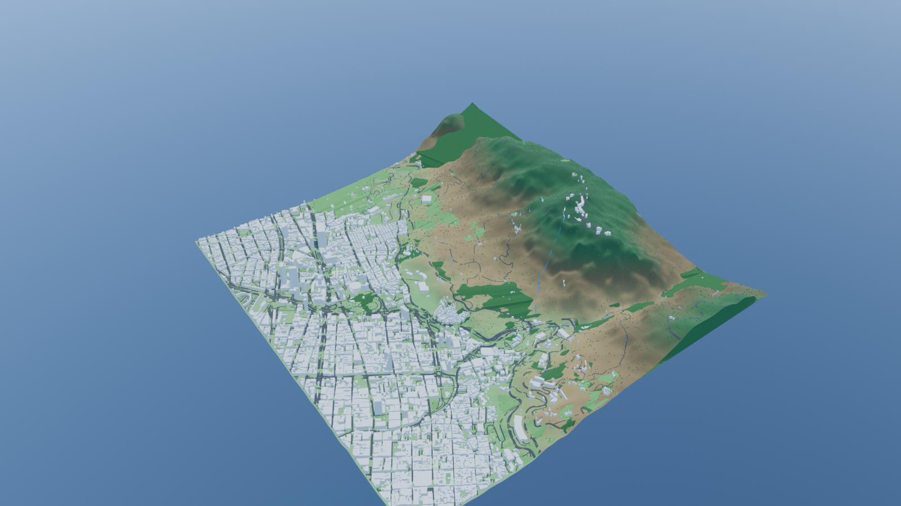
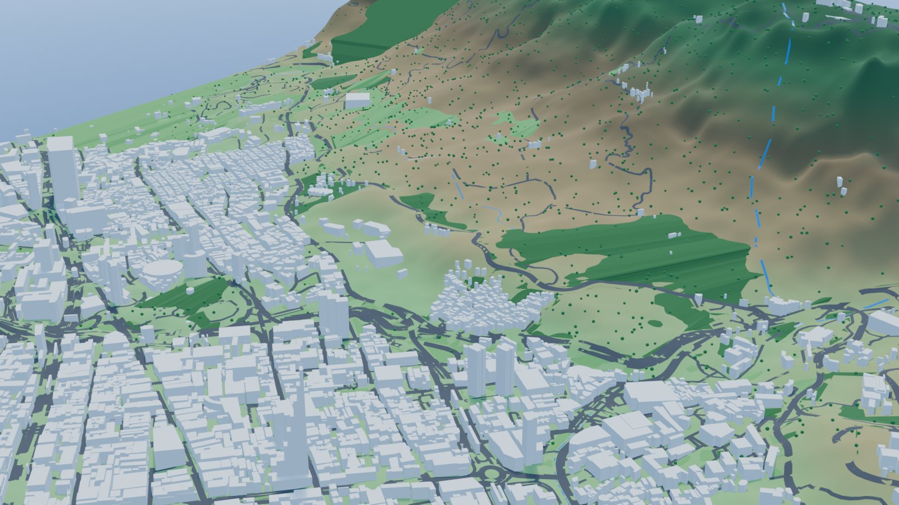

# Bogotá 3D

Mapa web 3D interactivo de Bogotá construido con MapLibre GL JS y three.js. El terreno y los edificios se muestran en cuatro bloques GLB generados en Blender y cargados sobre el estilo base de OpenFreeMap.

## Enlaces

- Repositorio: [github.com/maicooljt8a-ops/Mapa-3D-bogota](https://github.com/maicooljt8a-ops/Mapa-3D-bogota)
- Sitio publicado: [maicooljt8a-ops.github.io/Mapa-3D-bogota](https://maicooljt8a-ops.github.io/Mapa-3D-bogota/)

## Galería

### Vista aérea

Vista general del terreno y de los bloques de edificios que cubren la zona ampliada de Bogotá.

### Centro de Bogotá

Acercamiento al centro histórico, con los edificios y las vías principales del modelo.

## Fuentes de datos

- **Overture Maps** para las huellas de edificios.
- **OpenStreetMap** para edificios, vías y puntos de interés.
- **AWS Terrain Tiles** para la elevación del terreno.

## Herramientas

- **Blender** con **MCP** para generar y exportar los modelos.
- **OpenCode** como asistente de desarrollo.
- **MapLibre GL JS** para el mapa y las capas.
- **three.js** para renderizar los bloques GLB.

## Alturas

Las alturas de los edificios son en su mayoría estimadas a partir de la huella y del número de niveles; solo una parte proviene de datos reales. El panel permite ajustar la exageración del terreno y el desplazamiento vertical de los edificios.

## Publicación

El flujo de GitHub Actions se dispara con cada push a `main` o manualmente desde la pestaña **Actions**. Antes de publicar verifica que existan `models/bloques/index.json`, los cuatro archivos `.glb` y `layers/sitios.geojson`, copia a `_site` solo `index.html`, `main.js`, `style.css`, `models/bloques/` y `layers/`, y despliega ese artefacto en GitHub Pages.
